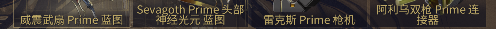

# 科学天诺 - Warframe 物品价格查询工具



## 重要警告

⚠️ **使用前请仔细阅读** ⚠️

1. **官方态度**：请先阅读 Warframe 官方对第三方工具的态度和相关政策：
   [第三方软件与您](https://support.warframe.com/hc/zh-cn/articles/360030014351-%E7%AC%AC%E4%B8%89%E6%96%B9%E8%BD%AF%E4%BB%B6%E4%B8%8E%E6%82%A8)
2. **技术原理**：本软件**不读取游戏内存**，仅通过截图并识别屏幕上的文字，然后通过公开 API 查询价格
3. **风险提示**：使用任何第三方工具都存在一定风险，包括但不限于账号处罚。请自行评估风险并承担使用后果
4. **合规使用**：请确保你的使用方式符合游戏的用户协议和相关法律法规

## 项目简介

**科学天诺**是一款专为 Warframe 玩家设计的物品价格查询工具，通过 OCR 技术识别游戏中的物品名称，并自动查询 Warframe Market 上的实时价格，帮助玩家快速了解物品价值，做出更明智的交易决策。

> 本项目基于原开源项目

## 功能特点

- 🎯 **精准识别**：使用先进的 OCR 技术识别游戏中的黄色物品名称
- 💰 **实时价格**：自动查询 Warframe Market 上的最新售价
- 🖱️ **自定义区域**：支持玩家自定义识别区域，适应不同分辨率
- 📋 **一键复制**：可将查询结果自动复制到剪贴板，方便分享
- ⌨️ **热键触发**：按 F8 键即可快速触发识别，无需切换窗口
- 🎨 **界面友好**：简洁直观的图形界面，支持自定义字号
- 🌐 **多语言支持**：同时支持中英文物品名称识别

## 系统要求

- Windows 7/8/10/11
- Python 3.7+
- 稳定的网络连接（用于查询价格）

## 安装说明

### 方法一：直接运行可执行文件（推荐）

1. 下载最新版本的可执行文件
2. 解压到任意文件夹
3. 直接运行 `科学天诺.exe` 即可

### 方法二：从源码运行

1. 克隆或下载本项目到本地：
   ```bash
   git clone https://github.com/DealthyX/KeXueTianNuo.git
   ```
2. 安装依赖包：
   ```bash
   pip install opencv-python numpy easyocr pandas requests tkinter Pillow pyautogui keyboard pyperclip
   ```
3. 运行主程序：
   ```bash
   python ui.py
   ```

## 使用教程

### 首次使用设置

1. **设置分辨率**：在界面上方输入你的电脑分辨率（例如：1920x1080）
2. **选择识别区域**：点击"选择识别位置"按钮，在弹出的截图中框选游戏中物品名称的显示区域
3. **保存设置**：设置完成后，系统会自动保存你的配置

### 开始查询价格

1. **启动脚本**：点击"启动脚本"按钮
2. **触发识别**：在游戏中，当你看到物品名称时，按 `F8` 键
3. **查看结果**：识别结果和价格会显示在弹出的"识别结果"窗口中
4. **复制结果**（可选）：如果勾选了"将结果复制到剪切板"，结果会自动复制

### 示例操作流程

1. 在游戏中打开物品栏或交易界面
2. 确保物品名称清晰可见（黄色文字）
3. 按 `F8` 键
4. 查看弹出窗口中的价格信息
5. 根据价格信息决定交易策略

## 常见问题

### Q: 识别失败怎么办？

**A:** 请检查以下几点：
- 确保物品名称是黄色的（游戏默认颜色）
- 调整识别区域，确保只包含物品名称部分
- 确保游戏画面清晰，无遮挡
- 尝试调整游戏分辨率或窗口大小

### Q: 价格查询失败怎么办？

**A:** 请检查以下几点：
- 确保网络连接正常
- 物品名称可能不在数据库中（如特殊物品或新物品）
- Warframe Market 服务器可能暂时不可用，请稍后再试

### Q: 如何提高识别准确率？

**A:** 建议：
- 在游戏设置中提高画面亮度
- 确保物品名称完全显示，无截断
- 选择合适的识别区域，不要包含过多背景
- 使用游戏默认字体和界面设置

## 注意事项

1. 本工具仅用于查询价格，不涉及任何游戏数据修改
2. 请合理使用本工具，遵守游戏社区规则
3. 价格数据来源于 Warframe Market，仅供参考
4. 本工具为开源免费软件，请勿用于商业用途
5. 使用过程中如遇问题，请联系开发者

## 技术原理

1. **截图**：使用 `pyautogui` 截取屏幕指定区域
2. **图像处理**：提取黄色文字，生成白底黄字图像
3. **OCR 识别**：使用 `EasyOCR` 识别图像中的文字
4. **名称匹配**：将识别结果与物品数据库匹配
5. **价格查询**：通过 Warframe Market API 查询价格
6. **结果显示**：在界面中显示识别结果和价格

## 数据说明

- 物品名称映射表：`wfm_item_names_en_zh.csv`
- 配置文件：`wfocr_config.json`（自动生成）
- 识别结果图片：程序运行时会在临时目录生成

## 联系方式

- 项目维护者：DealthyX
- 邮箱：DealthyX@outlook.com
- 反馈问题或建议，请发送邮件并附上详细说明

## 致谢

特别感谢原项目开发者 Green00101 为科学天诺工具做出的贡献，本项目是在原项目基础上进行优化和更新。

## 开源声明

本项目采用 MIT 开源许可证，欢迎大家贡献代码和提出建议，共同完善这个工具。

---

**免责声明**：本工具仅供个人使用，与 Digital Extremes 公司无关。使用本工具时请遵守 Warframe 游戏的用户协议。

祝各位天诺战士游戏愉快！🚀
